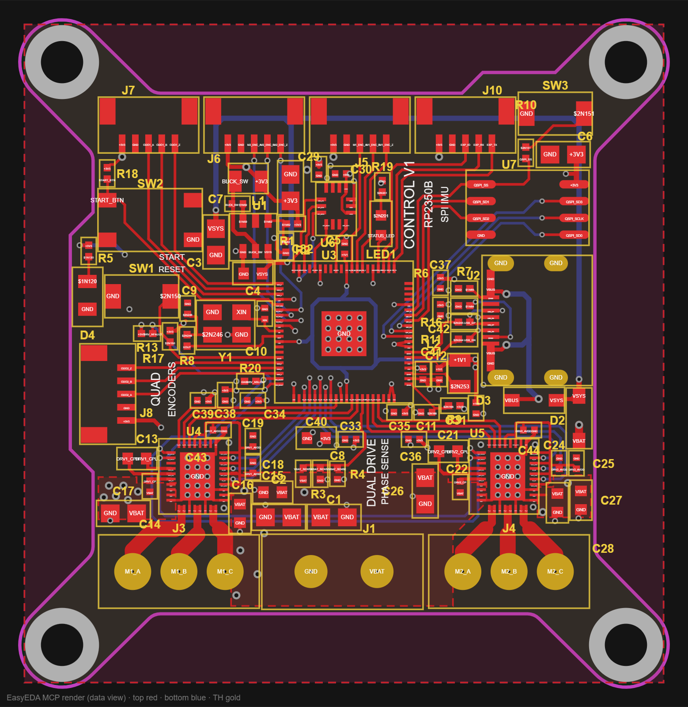

# EV Controller v1

Controller board for the 2027 Science Olympiad Div C Electric Vehicle, designed in EasyEDA Pro.

## Overview

| | |
|---|---|
| MCU | RP2350B (QFN-80) + W25Q128JV 16 MB QSPI flash, 12 MHz crystal |
| Motor drivers | 2x DRV8317H, 3x PWM mode, 3 current-sense amps each (0.25 V/A) |
| IMU | ICM-42688-P on SPI0 |
| Power | XT30 battery input (8x AA NiMH/alkaline, up to ~12.8 V), TPS54202 buck to 3.3 V, USB-C VBUS/VBAT Schottky OR-ing |
| Motor outputs | 2x MR30 (3-phase BLDC) |
| I/O | 5x SH1.0 5-pin ports (2 motor encoders, 2 odometry encoders, UART/expansion), START + RESET + BOOT buttons, status LED |
| Board | 4-layer, 38 x 39.4 mm body + 4 corner tabs with M3 holes (GND), 1 oz copper |

Stackup: L1 signals + VBAT/GND pours, L2 solid GND plane, L3 VBAT / +3V3 split, L4 signals + GND pour.

## Files

| Folder | Contents |
|---|---|
| `fabrication/` | JLCPCB upload set: Gerber + drill zip, BOM, pick-and-place (CPL) |
| `schematic/` | Schematic PDF, schematic BOM, netlist |
| `pcb/` | STEP 3D model, PCB netlist, render |
| `project/` | EasyEDA Pro project (`.epro`), open with File > Import |

## Ordering (JLCPCB)

1. Upload `fabrication/*_Gerber.zip`, 4 layers, 1.6 mm, 1 oz.
2. Enable PCBA (Economic works: every part is Economic-compatible), top side.
3. Upload the BOM and CPL from `fabrication/`.

20 Basic + 11 Extended parts. Low-stock parts to watch: DRV8317HREER, MR30PB-M, ABM8-272-T3.

## Status

EasyEDA DRC: 0 violations, 81/81 nets routed.
