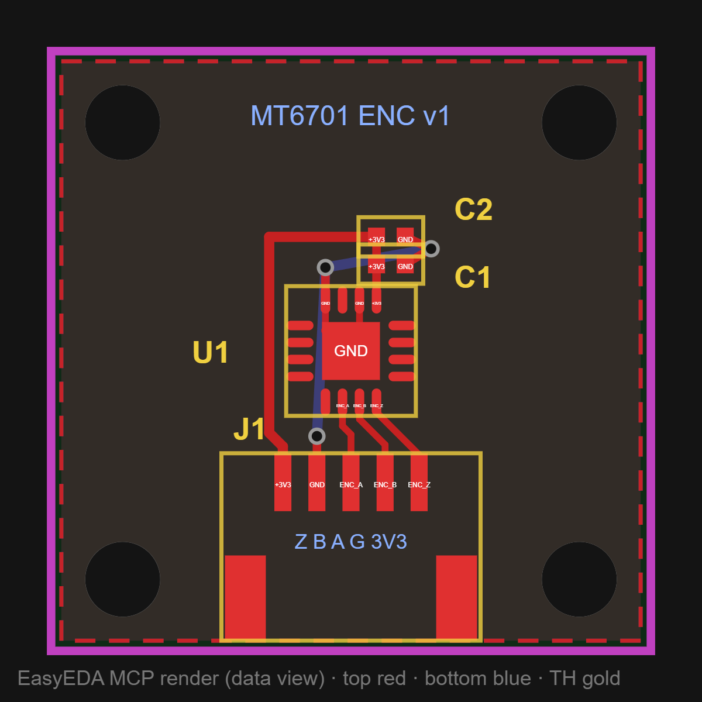

# EV Encoder v1 (MT6701)

Magnetic rotary encoder board for the 2027 Science Olympiad Div C Electric Vehicle. Four per car: motor 1, motor 2, odometry 1, odometry 2. Plugs into J5-J8 on [controller-v1](../controller-v1).

## Overview

| | |
|---|---|
| Sensor | MT6701QT-ACD (QFN-16 3x3, 0.75 mm tall), factory-programmed: ABZ, 1024 PPR (4096 counts/rev), Z width 1 LSB, CCW = count up |
| Output | A/B/Z quadrature, 3.3 V push-pull. No SPI/I2C on the cable. MODE is tied to GND, which selects ABZ |
| Power | 3.3 V from the controller, ~10-14 mA. 100 nF + 1 uF decoupling |
| Connector | J1 ZX-SH1.0-5PWT (JST SH-compatible 1.0 mm, right angle, 3.15 mm tall) |
| Board | 17.6 x 17.6 mm square, 2-layer, 4x M2 holes (2.2 mm NPTH) in the corners on a 13.4 mm square |

The sensor's sensing center (package center) is exactly at the center of the four holes and the board. The bottom silkscreen has a crosshair at that point.

## Pinout (matches controller J5-J8)

| Pin | Signal |
|---|---|
| 1 | +3V3 |
| 2 | GND |
| 3 | A |
| 4 | B |
| 5 | Z |

## Files

| Folder | Contents |
|---|---|
| `fabrication/` | JLCPCB upload set: Gerber + drill zip, BOM, pick-and-place (CPL) |
| `schematic/` | Schematic PDF, schematic BOM, netlist |
| `pcb/` | STEP 3D model, PCB netlist, render |
| `project/` | EasyEDA Pro project with both boards (controller = Board1, encoder = "Encoder MT6701"), open with File > Import |

## Ordering (JLCPCB)

1. Upload `fabrication/*_Gerber.zip`, 2 layers, **0.8 mm** thickness, 1 oz.
2. PCBA: Economic, top side, quantity 8 (2 cars x 4) or more.
3. Upload the BOM and CPL from `fabrication/`.

2 Basic + 2 Extended parts. MT6701QT-ACD (C49257133) stock is low (~34 when designed). Do not substitute MT6701QT-STD: it ships at 1 pulse/rev, and its EEPROM can only be reprogrammed with VDD > 4.5 V.

## Mounting

- Magnet: 6 x 2.5 mm diametrically magnetized NdFeB disc, glued to the shaft end, centered within 0.3 mm of the sensor.
- Air gap: 0.5-2.0 mm between the magnet and the chip's top surface (1.0 mm typical).
- The chip and the connector are on the same side (facing the magnet). Either the standoffs must be taller than the connector (3.15 mm), or the connector edge must hang past the motor outline.
- A/B outputs start about 50 ms after power-up.

## Cables

JST SH 1.0 mm 5-pin double-ended pre-crimped cables, wired **pin 1 to pin 1** (often sold as "same direction"). Many ready-made SH cables are reversed (pin 1 to pin 5), which would put 3.3 V on Z. Check with a multimeter before plugging in.

## Status

EasyEDA DRC: 0 violations, 5/5 nets routed.
